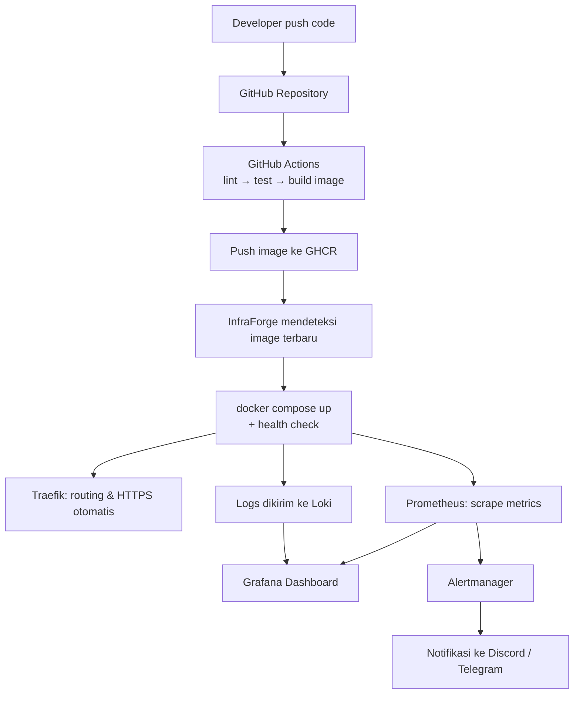
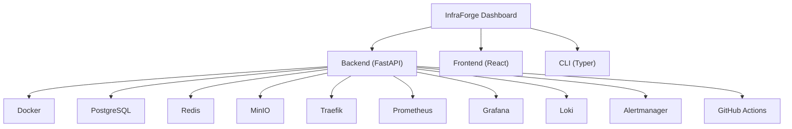

# InfraForge

**Platform DevOps self-hosted open source** untuk membangun, mendeploy, memonitor, dan mengelola aplikasi semuanya dari satu dashboard terpusat.

> Bukan sekadar "dashboard Docker". InfraForge adalah **Internal Developer Platform (IDP)** sederhana yang menyatukan tool-tool DevOps yang biasanya berdiri sendiri (Docker, Traefik, Prometheus, Grafana, Loki, GitHub Actions) menjadi satu alur kerja yang mulus.

---

## Daftar Isi

- [Masalah yang Diselesaikan](#masalah-yang-diselesaikan)
- [Cara Kerja](#cara-kerja)
- [Arsitektur](#arsitektur)
- [Fitur Utama](#fitur-utama)
- [Tech Stack](#tech-stack)
- [Struktur Folder](#struktur-folder)
- [Getting Started](#getting-started)
- [Alerting](#alerting)
- [Milestone 4 — Verifikasi Observability](#milestone-4--verifikasi-observability)
- [Roadmap](#roadmap)
- [Kenapa Namanya InfraForge?](#kenapa-namanya-infraforge)
- [Lisensi](#lisensi)

---

## Masalah yang Diselesaikan

Tanpa InfraForge, deploy aplikasi biasanya melewati banyak tool yang terpisah:

```
GitHub → GitHub Actions → Docker Build → Docker Push → SSH ke VPS
   → docker compose pull → docker compose up
   → buka Grafana → buka Prometheus → buka Loki
   → cek logs → cek container → cek SSL → backup database
```

Dengan InfraForge, alurnya jadi:

```
Push Code → GitHub Actions → InfraForge → Deploy
```

Sisanya routing, HTTPS, monitoring, logging, alerting, backup ditangani otomatis oleh platform.

---

## Cara Kerja



1. **Push** -> developer push code ke GitHub.
2. **CI** -> GitHub Actions menjalankan lint, test, build image, lalu push ke GHCR.
3. **Deploy** -> InfraForge menarik image terbaru dan menjalankan `docker compose up` beserta health check.
4. **Routing** -> Traefik otomatis membuat routing dan HTTPS untuk domain aplikasi.
5. **Observability** -> Prometheus mengambil metric, Loki mengumpulkan log, semuanya tampil di Grafana.
6. **Alerting** -> Alertmanager mengirim notifikasi ke Discord/Telegram saat CPU tinggi, RAM penuh, atau container mati.

---

## Arsitektur



---

## Fitur Utama

| Kategori | Detail |
|---|---|
| **Deployment** | Deploy aplikasi hanya dengan beberapa klik |
| **Container Management** | Start, stop, restart, delete, view logs |
| **Monitoring** | CPU, RAM, Disk, Docker, Network, Uptime |
| **Logging** | Lihat log seluruh container dari satu tempat |
| **Alerting** | Rules Prometheus, riwayat alert, notifikasi Discord/Telegram |
| **Project Management** | Satu server bisa kelola banyak project sekaligus |
| **Authentication** | JWT-based authentication |
| **Backup** | Backup database & file ke MinIO |
| **Dashboard** | Ringkasan container, resource usage, deployment history, alerts |

---

## Tech Stack

**Language**


**Backend**


**Frontend**


**Database**


**Cache**


**Reverse Proxy**


**SSL**


**Container**


**Container Registry**


**CI/CD**


**Monitoring**


**Logging**


**Alerting**


**Object Storage**


**Documentation**


**Testing**


**API Testing**


**CLI**


**DNS**


---

## Struktur Folder

```
InfraForge/
├── backend/          # FastAPI app (api, core, models, services, dst)
├── frontend/         # React app
├── infrastructure/   # Config Traefik, Postgres, Redis, MinIO, Prometheus, Grafana, Loki, dst
├── cli/              # CLI berbasis Typer
├── docs/             # Dokumentasi tambahan
├── .github/workflows # CI/CD pipelines
└── docker-compose.yml
```

---

## Getting Started

```bash
git clone https://github.com/Varaaa-arch/InfraForge.git
cd InfraForge
cp backend/.env.example backend/.env
# Sesuaikan SECRET_KEY dan ENCRYPTION_KEY di backend/.env sebelum production:
#   openssl rand -hex 32
docker compose up -d
```

- Dashboard: http://localhost:5173
- API / Swagger: http://localhost:8000/docs (via dashboard: http://localhost:5173/api/docs)
- Prometheus: http://localhost:9090
- Alertmanager: http://localhost:9093
- cAdvisor: http://localhost:8081
- Loki: http://localhost:3100

Frontend dibangun sebagai image statis dan dilayani nginx. nginx mem-proxy
request `/api` (REST + WebSocket) ke backend, sehingga dashboard tetap
same-origin. Untuk pengembangan lokal tanpa Docker:

```bash
cd frontend
npm install
npm run dev
```

> Setup lengkap masih dalam pengembangan, instruksi detail akan ditambahkan seiring progress.

### Akun demo & data contoh

Belum punya akun? Buka http://localhost:5173/register untuk mendaftar langsung
dari dashboard.

Untuk mengisi aplikasi dengan data contoh (project, server, aplikasi,
deployment, environment variable, riwayat alert, dan channel notifikasi
nonaktif), jalankan seeder. Seeder bersifat idempotent — aman dijalankan
berkali-kali karena data demo lama dibuat ulang:

```bash
docker compose exec backend uv run --no-dev python scripts/seed_demo.py
```

| Kredensial | Nilai |
|---|---|
| Username | `demo` |
| Password | `demo1234` |

| Data | Jumlah |
|---|---|
| Project | 1 |
| Server | 2 |
| Aplikasi | 2 |
| Deployment | 4 |
| Environment variable | 2 |
| Riwayat alert | 24 (firing & resolved) |
| Channel notifikasi | 1 (nonaktif) |

> Channel **Demo Discord (nonaktif)** berisi URL webhook placeholder. Ganti
> dengan URL asli lewat halaman Alerts sebelum diaktifkan.

---

## Alerting

Alert mengalir dari Prometheus ke Alertmanager, lalu diteruskan ke backend
InfraForge lewat webhook terautentikasi. Backend menyimpan riwayat alert dan
mengirim notifikasi ke channel Discord/Telegram yang aktif.

```
Prometheus rules → Alertmanager (9093)
  → POST /alerts/webhook (X-InfraForge-Token)
  → PostgreSQL + Discord/Telegram
```

Akses halaman **Alerts** di dashboard untuk melihat riwayat firing/resolved dan
mengelola channel notifikasi (tambah, aktif/nonaktif, test, hapus).

**Rules bawaan**

| Rule | Kondisi |
|---|---|
| `HighHostCPUUsage` | CPU host > 90% selama 5 menit |
| `HighHostMemoryUsage` | RAM host > 90% selama 5 menit |
| `HighDiskUsage` | Disk host > 90% selama 5 menit |
| `InfraContainerDown` | Container compose `infraforge` mati selama 2 menit |
| `ContainerRestartLoop` | Restart container > 2 kali dalam 15 menit |
| `DockerDaemonUnavailable` | Docker daemon tidak terdeteksi |
| `MonitoringTargetDown` | Target scrape Prometheus down |

**Konfigurasi**

- `ALERT_WEBHOOK_SECRET` — token header `X-InfraForge-Token`; harus sama di
  backend dan Alertmanager. Default development: `dev-alert-token`. Ganti di
  production.
- `ALERT_REQUEST_TIMEOUT` — timeout pengiriman notifikasi (detik, default 10).
- Webhook Alertmanager diarahkan ke `http://backend:8000/alerts/webhook` pada
  `infrastructure/alertmanager/alertmanager.yml`.

> Catatan: cAdvisor pada host dengan storage containerd/overlayfs tertentu tidak
> dapat melihat container Docker. Metrik container (`up`, restart count)
> dipasok exporter backend di `GET /metrics`, sedangkan rule CPU/RAM/Disk
> berbasis metrik host dari node-exporter.

---

## Milestone 4 — Verifikasi Observability

DoD Milestone 4 sudah diverifikasi end-to-end. Bukti lengkap (tabel waktu,
perintah reproduksi, dan hasil pengujian) ada di
[`docs/milestone-4-verification.md`](docs/milestone-4-verification.md).

- **Metrik** — 5/5 target Prometheus `up` (prometheus, node-exporter, cAdvisor,
  Alertmanager, backend). Exporter backend mengekspos
  `infraforge_container_cpu_percent` dan `infraforge_container_memory_bytes`
  dengan label container, lalu Prometheus men-scrape-nya untuk tren historis.
- **Log real-time** — Loki + Promtail mengindeks log container; live tail
  lewat `WS /ws/logs` (diuji E2E). Port Promtail `9080` dipublikasikan untuk
  debugging (`/targets`, `/ready`, `/metrics`).
- **Alert Discord** — canary alert menempuh jalur lengkap
  Prometheus → Alertmanager → webhook backend → `alert_events` → Discord
  `InfraDC` (firing dan resolved), lalu rule canary dihapus.
- **UI** — Overview (6 kartu + health server), Monitoring (4 grafik +
  panel Top container), Alerts (tabel), dan Logs; E2E Playwright lulus
  (24/24, 9/9, dan 5/5) tanpa page error.

---

## Roadmap

- [x] Centralized logging (Loki + Promtail + WebSocket tail)
- [x] Monitoring stack (Prometheus, Node Exporter, cAdvisor)
- [x] Alerting (Alertmanager, webhook relay, Discord/Telegram)
- [ ] UI manajemen server, aplikasi, dan deployment
- [ ] Grafana dashboards & Traefik reverse proxy
- [ ] Object storage MinIO untuk artefak deployment
- [ ] Backup receiver Alertmanager (cadangan saat backend down)

---

## Kenapa Namanya InfraForge?

- **Infra** = Infrastructure
- **Forge** = menempa, membangun sesuatu yang kuat

> *"Tempat untuk membangun, mengelola, dan mengoperasikan infrastruktur aplikasi."*

Nama ini sengaja dibuat fleksibel saat project berkembang ke arah Kubernetes, GitOps, atau multi-cloud, nama **InfraForge** tetap relevan.

---

## Lisensi

Proyek ini dilisensikan di bawah **Apache License 2.0**. Lihat file [LICENSE](LICENSE) untuk informasi selengkapnya.