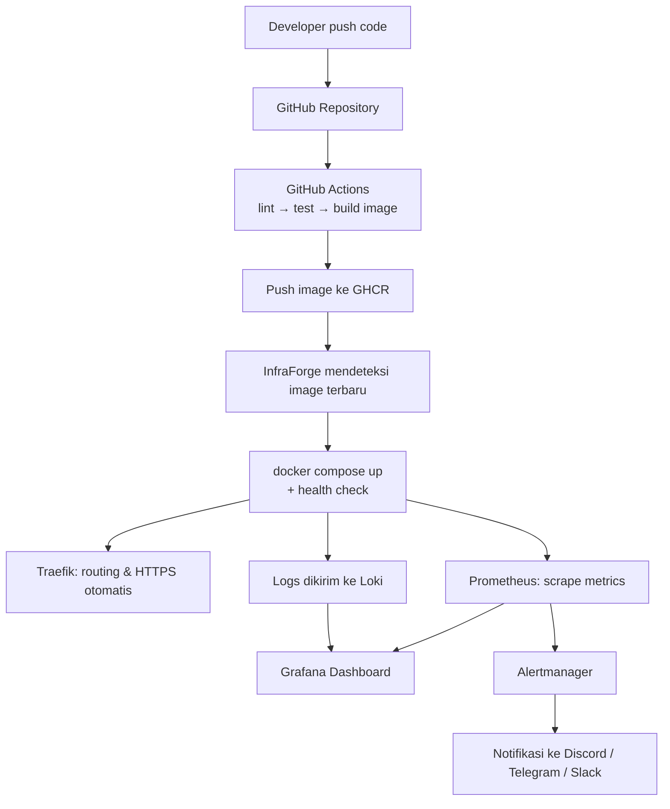
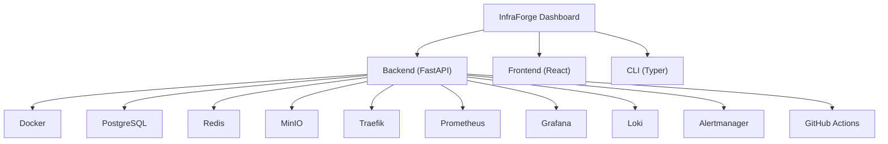

# InfraForge

**Platform DevOps self-hosted open source** untuk membangun, mendeploy, memonitor, dan mengelola aplikasi semuanya dari satu dashboard terpusat.

> Bukan sekadar "dashboard Docker". InfraForge adalah **Internal Developer Platform (IDP)** sederhana yang menyatukan tool-tool DevOps yang biasanya berdiri sendiri (Docker, Traefik, Prometheus, Grafana, Loki, GitHub Actions) menjadi satu alur kerja yang mulus.

---

## Daftar Isi

- [Masalah yang Diselesaikan](#masalah-yang-diselesaikan)
- [Cara Kerja](#cara-kerja)
- [Arsitektur](#arsitektur)
- [Fitur Utama](#fitur-utama)
- [Tech Stack](#tech-stack)
- [Struktur Folder](#struktur-folder)
- [Getting Started](#getting-started)
- [Alerting](#alerting)
- [Milestone 6 Fase 1 — Multi-Channel Alert](#milestone-6-fase-1--multi-channel-alert)
- [Milestone 6 Fase 2 — Auto-Healing & Resource Container](#milestone-6-fase-2--auto-healing--resource-container)
- [Milestone 6 Fase 3 — CI/CD Trigger Tokens](#milestone-6-fase-3--cicd-trigger-tokens)
- [Milestone 7 Fase 1 — Webhook Receiver & Deployment Automation](#milestone-7-fase-1--webhook-receiver--deployment-automation)
- [Milestone 7 Fase 2 — Deployment Version History & Instant Rollback](#milestone-7-fase-2--deployment-version-history--instant-rollback)
- [Milestone 7 Fase 3 — Git Provider Integration & Live Deployment Logs](#milestone-7-fase-3--git-provider-integration--live-deployment-logs)
- [Milestone 7 Fase 4 — Token Rotation, Security Alerts & Playwright E2E](#milestone-7-fase-4--token-rotation-security-alerts--playwright-e2e)
- [Milestone 8 Fase 1 — Container Image Vulnerability Scanning](#milestone-8-fase-1--container-image-vulnerability-scanning)
- [Milestone 8 Fase 2 — TLS/SSL Domain Certificate Monitoring](#milestone-8-fase-2--tlsssl-domain-certificate-monitoring)
- [Manajemen Infrastruktur UI](#manajemen-infrastruktur-ui)
- [Manajemen Konfigurasi & Rahasia](#manajemen-konfigurasi-rahasia)
- [Tata Kelola Platform](#tata-kelola-platform)
- [Milestone 4 — Verifikasi Observability](#milestone-4--verifikasi-observability)
- [Roadmap](#roadmap)
- [Kenapa Namanya InfraForge?](#kenapa-namanya-infraforge)
- [Lisensi](#lisensi)

---

## Masalah yang Diselesaikan

Tanpa InfraForge, deploy aplikasi biasanya melewati banyak tool yang terpisah:

```
GitHub → GitHub Actions → Docker Build → Docker Push → SSH ke VPS
   → docker compose pull → docker compose up
   → buka Grafana → buka Prometheus → buka Loki
   → cek logs → cek container → cek SSL → backup database
```

Dengan InfraForge, alurnya jadi:

```
Push Code → GitHub Actions → InfraForge → Deploy
```

Sisanya routing, HTTPS, monitoring, logging, alerting, backup ditangani otomatis oleh platform.

---

## Cara Kerja



1. **Push** -> developer push code ke GitHub.
2. **CI** -> GitHub Actions menjalankan lint, test, build image, lalu push ke GHCR.
3. **Deploy** -> InfraForge menarik image terbaru dan menjalankan `docker compose up` beserta health check.
4. **Routing** -> Traefik otomatis membuat routing dan HTTPS untuk domain aplikasi.
5. **Observability** -> Prometheus mengambil metric, Loki mengumpulkan log, semuanya tampil di Grafana.
6. **Alerting** -> Alertmanager mengirim notifikasi ke Discord/Telegram/Slack sesuai severity saat CPU tinggi, RAM penuh, atau container mati.

---

## Arsitektur



---

## Fitur Utama

| Kategori | Detail |
|---|---|
| **Deployment** | Deploy aplikasi, riwayat tag/commit/pemicu per project, dan rollback instan ke versi stabil |
| **CI/CD Integration** | Token project/aplikasi dengan rotasi aman, koneksi repository, webhook GitHub/GitLab dengan filter branch per aplikasi, live log deployment, idempotency, audit, alert security, dan E2E Playwright |
| **Container Management** | Start, stop, restart, delete, view logs, limit CPU/memory & auto-healing |
| **Container Security** | Pemindaian CVE image dengan Trivy, riwayat scan, detail finding, rescan, dan alert threshold CRITICAL/HIGH |
| **TLS/SSL Monitoring** | Pemantauan expiry & validitas sertifikat domain, deteksi self-signed/hostname mismatch, riwayat cek, recheck manual, dan alert |
| **Infrastructure UI** | Halaman Servers (CRUD + status exporter Prometheus) & Containers (health, port mapping, CPU/RAM, lifecycle, inspect, resource limit, tab Auto-Healing) |
| **Configuration & Secrets** | Environment variable per project terenkripsi (Fernet), secret masking, indikator re-deploy, bulk import `.env` |
| **Monitoring** | CPU, RAM, Disk, Docker, Network, Uptime |
| **Logging** | Lihat log seluruh container dari satu tempat |
| **Alerting** | Rules Prometheus warning & critical, riwayat alert, notifikasi Discord/Telegram/Slack dengan routing severity |
| **Project Management** | Satu server bisa kelola banyak project sekaligus |
| **Authentication** | JWT-based authentication |
| **Backup** | Backup database & file ke MinIO |
| **Dashboard** | Ringkasan container, resource usage, deployment history, alerts |

---

## Tech Stack

**Language**


**Backend**


**Frontend**


**Database**


**Cache**


**Reverse Proxy**


**SSL**


**Container**


**Container Registry**


**CI/CD**


**Monitoring**


**Logging**


**Alerting**


**Object Storage**


**Documentation**


**Testing**


**API Testing**


**CLI**


**DNS**


---

## Struktur Folder

```
InfraForge/
├── backend/          # FastAPI app (api, core, models, services, dst)
├── frontend/         # React app
│   └── src/
│       ├── pages/    # Overview, Monitoring, Logs, Alerts, Servers, Containers, Projects
│       └── components/ # UI per fitur (servers, containers, projects, monitoring, alerts, logs)
├── infrastructure/   # Config Traefik, Postgres, Redis, MinIO, Prometheus, Grafana, Loki, dst
├── cli/              # CLI berbasis Typer
├── docs/             # Dokumentasi tambahan
├── .github/workflows # CI/CD pipelines
└── docker-compose.yml
```

---

## Getting Started

```bash
git clone https://github.com/Varaaa-arch/InfraForge.git
cd InfraForge
cp backend/.env.example backend/.env
# Sesuaikan SECRET_KEY dan ENCRYPTION_KEY di backend/.env sebelum production:
#   openssl rand -hex 32
docker compose up -d
```

- Dashboard: http://localhost:5173
- API / Swagger: http://localhost:8000/docs (via dashboard: http://localhost:5173/api/docs)
- Prometheus: http://localhost:9090
- Alertmanager: http://localhost:9093
- cAdvisor: http://localhost:8081
- Loki: http://localhost:3100

Frontend dibangun sebagai image statis dan dilayani nginx. nginx mem-proxy
request `/api` (REST + WebSocket) ke backend, sehingga dashboard tetap
same-origin. Untuk pengembangan lokal tanpa Docker:

```bash
cd frontend
npm install
npm run dev
```

> Setup lengkap masih dalam pengembangan, instruksi detail akan ditambahkan seiring progress.

### Akun demo & data contoh

Belum punya akun? Buka http://localhost:5173/register untuk mendaftar langsung
dari dashboard.

Untuk mengisi aplikasi dengan data contoh (project, server, aplikasi,
deployment, environment variable, riwayat alert, dan channel notifikasi
nonaktif), jalankan seeder. Seeder bersifat idempotent — aman dijalankan
berkali-kali karena data demo lama dibuat ulang:

```bash
docker compose exec backend uv run --no-dev python scripts/seed_demo.py
```

| Kredensial | Nilai |
|---|---|
| Username | `demo` |
| Password | `demo1234` |

| Data | Jumlah |
|---|---|
| Project | 1 |
| Server | 2 |
| Aplikasi | 2 |
| Deployment | 4 |
| Environment variable | 2 |
| Riwayat alert | 24 (firing & resolved) |
| Channel notifikasi | 1 (nonaktif) |

> Channel **Demo Discord (nonaktif)** berisi URL webhook placeholder. Ganti
> dengan URL asli lewat halaman Alerts sebelum diaktifkan.

---

## Alerting

Alert mengalir dari Prometheus ke Alertmanager, lalu diteruskan ke backend
InfraForge lewat webhook terautentikasi. Backend menyimpan riwayat alert dan
mengirim notifikasi ke channel Discord, Telegram, atau Slack yang aktif sesuai
threshold severity masing-masing.

```
Prometheus rules → Alertmanager (9093)
  → POST /alerts/webhook (X-InfraForge-Token)
  → PostgreSQL + Discord/Telegram/Slack
```

Kelola channel di **Settings → Notifikasi** (admin): tambah channel, atur
threshold **Semua severity / Warning ke atas / Hanya critical**, kirim test,
ubah, aktif/nonaktif, atau hapus. Halaman **Alerts** menampilkan riwayat
firing/resolved dan ringkasan channel dengan tautan ke pengaturan.

**Rules bawaan**

| Rule | Kondisi | Severity |
|---|---|---|
| `HighHostCPUUsageWarning` | CPU host > 75% selama 5 menit | warning |
| `HighHostMemoryUsageWarning` | RAM host > 75% selama 5 menit | warning |
| `HighDiskUsageWarning` | Disk host > 80% selama 5 menit | warning |
| `HighHostCPUUsage` | CPU host > 90% selama 5 menit | critical |
| `HighHostMemoryUsage` | RAM host > 90% selama 5 menit | critical |
| `HighDiskUsage` | Disk host > 90% selama 5 menit | critical |
| `InfraContainerDown` | Container compose `infraforge` mati selama 2 menit | critical |
| `ContainerRestartLoop` | Restart container > 2 kali dalam 15 menit | critical |
| `DockerDaemonUnavailable` | Docker daemon tidak terdeteksi | critical |
| `MonitoringTargetDown` | Target scrape Prometheus down | critical |

**Konfigurasi**

- `ALERT_WEBHOOK_SECRET` — token header `X-InfraForge-Token`; harus sama di
  backend dan Alertmanager. Default development: `dev-alert-token`. Ganti di
  production.
- `ALERT_REQUEST_TIMEOUT` — timeout pengiriman notifikasi (detik, default 10).
- Webhook Alertmanager diarahkan ke `http://backend:8000/alerts/webhook` pada
  `infrastructure/alertmanager/alertmanager.yml`.
- `host.docker.internal:host-gateway` dipetakan ke container backend agar
  webhook uji di host (mock E2E) dapat dijangkau dari dalam container.

> Catatan: cAdvisor pada host dengan storage containerd/overlayfs tertentu tidak
> dapat melihat container Docker. Metrik container (`up`, restart count)
> dipasok exporter backend di `GET /metrics`, sedangkan rule CPU/RAM/Disk
> berbasis metrik host dari node-exporter.

---

## Milestone 6 Fase 1 — Multi-Channel Alert

Tim tidak perlu terus menatap dashboard: alert dikirim otomatis ke Discord,
Telegram, atau Slack sesuai severity.

- **Alert destination di Settings** — tab Notifikasi mengelola channel
  (Discord webhook, Telegram bot token + chat ID, Slack incoming webhook),
  threshold severity, status aktif, serta aksi ubah/hapus.
- **Routing otomatis** — channel `info` menerima semua alert, `warning`
  menerima warning + critical, dan `critical` hanya menerima critical.
  Alert resolved mengikuti severity aslinya.
- **Test notification** — tombol per channel mengirim pesan uji nyata dan
  menampilkan alasan kegagalan dari backend bila webhook tidak dapat dijangkau.

> Rincian kontrak API, migrasi, matriks routing, dan bukti pengujian ada di
> [`docs/milestone-6-phase-1.md`](docs/milestone-6-phase-1.md).

---

## Milestone 6 Fase 2 — Auto-Healing & Resource Container

Container yang dijalankan lewat Docker Compose bisa diberi batas resource dan
dipantau kesehatannya langsung dari dashboard.

- **Resource limit per container** — dialog di halaman Containers mengatur
  CPU (cores), memory (MiB), dan restart policy. Limit langsung diterapkan ke
  container running dan disimpan agar dipasang ulang saat start/restart atau
  setelah `docker compose up`.
- **Auto-healing opt-in** — aktifkan per container dengan ambang unhealthy,
  batas restart per window, dan cooldown. Worker backend memantau healthcheck
  dan me-restart container yang gagal berturut-turut.
- **Tab Auto-Healing** — status worker, daftar policy, dan 25 insiden terbaru
  (unhealthy, auto-restart, recovered) dalam satu tempat.
- **Jejak audit** — setiap insiden dan perubahan policy tercatat di Audit Logs
  sebagai system event.
- **RBAC** — hanya developer/admin yang dapat mengubah policy; viewer tetap
  bisa memantau status dan insiden.

> Rincian kontrak API, konfigurasi worker, migrasi, dan bukti pengujian ada di
> [`docs/milestone-6-phase-2.md`](docs/milestone-6-phase-2.md).

---

## Milestone 6 Fase 3 — CI/CD Trigger Tokens

Pipeline CI/CD dapat memicu deployment tanpa menyimpan JWT user: setiap project
punya deployment token sendiri dan endpoint publik yang aman.

- **Deployment token per project** — tab CI/CD pada detail project membuat
  token `dt_...` dengan masa berlaku. Plaintext hanya ditampilkan sekali
  beserta snippet curl dan GitHub Actions; sisanya disimpan sebagai hash.
- **Endpoint publik** — `POST /api/deploy/trigger/<token>` menerima branch
  opsional dan langsung membalas `202` dengan `deployment_id`. Deployment
  berjalan di background; token dapat dicabut kapan saja.
- **Riwayat deployment project** — tab Deployment menampilkan pemicu
  (Manual/GitHub Webhook/CI Token), branch, commit, status, dan durasi dengan
  polling adaptif sehingga hasil CI/CD muncul tanpa refresh.
- **Jejak audit & pengamanan** — pembuatan/pencabutan token dan setiap trigger
  tercatat di Audit Logs; token mentah diredaksi dari path audit.
- **RBAC** — hanya pemilik project dengan peran developer/admin yang dapat
  mengelola token; pengguna lain melihat tampilan read-only.

Endpoint `/api/deploy/trigger/<token>` tetap didukung. Milestone 7 Fase 1
menambahkan receiver webhook native dan scope aplikasi tanpa memutus integrasi
yang sudah ada.

> Rincian kontrak API, contoh workflow, migrasi, dan bukti pengujian ada di
> [`docs/milestone-6-phase-3.md`](docs/milestone-6-phase-3.md).

---

## Milestone 7 Fase 1 — Webhook Receiver & Deployment Automation

Integrasi CI/CD ditingkatkan dari sekadar trigger token menjadi receiver
webhook yang siap dipakai GitHub, GitLab, dan pipeline lain.

- **Token project atau aplikasi** — token baru bisa dibatasi ke satu aplikasi;
  token lama otomatis berlaku untuk seluruh project. Select cakupan tersedia di
  tab CI/CD dan batasannya divalidasi di backend.
- **Webhook native** — `POST /api/v1/deploy/webhook/<token>` memverifikasi
  HMAC-SHA256 GitHub (`X-Hub-Signature-256`) atau secret GitLab
  (`X-Gitlab-Token`), membaca repository/branch/commit dari event push, dan
  menjadwalkan deployment aplikasi yang cocok.
- **Mode CI sederhana** — request tanpa header native memakai body JSON
  `application_id`/`branch`/`server_id`. Idempotency memakai
  `Idempotency-Key`; GitHub/GitLab memakai delivery ID masing-masing.
- **Anti-retry storm** — event non-push, tanpa target, duplikat, atau target
  terkunci dibalas `202` dengan `accepted=false`, sehingga provider tidak
  mengulang event yang tidak relevan.
- **Audit aman** — action `DEPLOY_WEBHOOK` mencatat sumber, event, repository,
  branch, commit, delivery, dan deployment terkait; token mentah diredaksi dari
  path audit.
- **Notifikasi deployment** — channel alert existing menerima pesan queued,
  success (`info`), dan failed (`critical`) untuk deployment CI/webhook.
- **UI lengkap** — cakupan token di tabel, plaintext sekali, snippet curl/GitHub
  Actions endpoint baru, serta panduan webhook native GitHub/GitLab.

> Rincian kontrak API, matriks status, migrasi, contoh webhook, dan bukti
> pengujian ada di
> [`docs/milestone-7-phase-1.md`](docs/milestone-7-phase-1.md).

---

## Milestone 7 Fase 2 — Deployment Version History & Instant Rollback

Riwayat deployment kini menjadi catatan versi yang bisa dipakai untuk kembali ke
rilis stabil sebelumnya tanpa menunggu pipeline baru.

- **Metadata versi** — setiap deployment menyimpan tag Git dan identitas pemicu
  (username, `deploy-token:<nama>`, atau identitas webhook), di samping commit
  dan branch yang sudah ada.
- **Riwayat lengkap** — tab Deployment menampilkan tag, commit pendek, branch,
  waktu rilis, pemicu, status, dan durasi; deployment gagal atau versi lama tetap
  terlihat.
- **Rollback instan** — tombol Rollback pada deployment sukses lama membuka
  dialog konfirmasi. Endpoint `POST /deployments/{id}/rollback` membalas `202`
  dan menjalankan deployment baru di background.
- **Snapshot exact** — rollback menyalin `tag`, `commit_sha`, branch, dan
  compose path target; clone commit exact diverifikasi sebelum build. Versi
  aktif tetap berjalan sampai health check rollback berhasil.
- **Aman dan terkontrol** — hanya pengguna dengan permission deploy yang dapat
  rollback; tombol disembunyikan untuk viewer, rilis stabil terbaru tidak
  ditawarkan sebagai target, dan lock deployment mencegah rollback ganda.
- **Audit** — operasi `ROLLBACK` mencatat user, deployment target, dan deployment
  rollback baru.

> Rincian kontrak API, migrasi, alur snapshot, cakupan E2E, dan batasan ada di
> [`docs/milestone-7-phase-2.md`](docs/milestone-7-phase-2.md).

---

## Milestone 7 Fase 3 — Git Provider Integration & Live Deployment Logs

Deployment berbasis Git kini lebih terkontrol dan proses build-nya bisa diamati
langsung dari dashboard.

- **Koneksi repository** — pemilik project dapat menyimpan URL repository,
  provider (GitHub/GitLab/Bitbucket), dan branch default lewat dialog Ringkasan.
- **Filter branch per aplikasi** — daftar branch exact (maksimal 20) menentukan
  push mana yang memicu deployment; aplikasi lama tetap memakai branch deploy
  sebagai fallback.
- **Helper webhook** — tab CI/CD memberi deep link ke halaman pengaturan webhook
  GitHub atau GitLab. Deployment token existing tetap menjadi secret webhook;
  tidak ada PAT/OAuth baru yang disimpan.
- **Live build/compose log** — tombol Log pada riwayat deployment membuka dialog
  streaming WebSocket. Setiap baris stdout/stderr muncul saat proses berjalan,
  bukan setelah build selesai.
- **Status dan pemulihan** — dialog menampilkan `Live`/`Selesai`/`Error`, tombol
  salin dan sambung ulang, serta tidak merender sentinel internal.
- **Perbaikan polling** — WebSocket melakukan expire identity map sebelum membaca
  status deployment agar sentinel selesai selalu terkirim saat proses lintas
  session berubah menjadi `success` atau `failed`.

> Rincian kontrak API, migrasi, keputusan desain, cakupan E2E, dan batasan ada di
> [`docs/milestone-7-phase-3.md`](docs/milestone-7-phase-3.md).

---

## Milestone 7 Fase 4 — Token Rotation, Security Alerts & Playwright E2E

Fase ini menutup DoD Milestone 7 dengan rotasi token yang aman, notifikasi
keamanan, dan E2E Playwright end-to-end.

- **Rotasi token** — endpoint `POST
  /projects/{id}/deploy-tokens/{token_id}/rotate` memperbarui secret in-place.
  ID, nama, cakupan aplikasi, dan expiry dipertahankan kecuali
  `expires_in_days` dikirim. Plaintext baru tampil sekali; token lama langsung
  tidak berlaku.
- **Guard token nonaktif** — token revoked atau expired tidak dapat dirotasi
  dan ditolak `409`; pengguna harus membuat token baru.
- **Audit rotasi** — action `DEPLOY_TOKEN_ROTATE` mencatat project dan token
  tanpa menyimpan plaintext.
- **Security alerts** — channel alert existing menerima event token
  created/rotated/revoked dan webhook yang ditolak/diabaikan. Event
  `scheduled` dilewati agar tidak menduplikasi notifikasi deployment queued.
- **UI rotasi** — tombol **Rotasi** pada token aktif membuka konfirmasi dan
  modal plaintext baru, dengan penjelasan bahwa token lama langsung tidak
  berlaku.
- **Playwright E2E** — satu skenario penuh: token → rotasi → webhook branch
  filter → riwayat → rollback → live log → audit, tanpa page error.
- **Seed deterministik** — `scripts/seed_m7_e2e.py` membuat user `e2e_m7`,
  project, aplikasi, deployment sukses lama/baru, dan deployment live log.

> Rincian kontrak API, matriks alert, perintah E2E, hasil verifikasi, dan
> batasan ada di
> [`docs/milestone-7-phase-4.md`](docs/milestone-7-phase-4.md).

---

## Milestone 8 Fase 1 — Container Image Vulnerability Scanning

Fase ini menambahkan halaman **Keamanan** (`/security`) dan API pemindaian
kerentanan image container berbasis Trivy.

- **Trigger scan & rescan** — pindai referensi image (mis. `nginx:1.27`) dengan
  atau tanpa project. Rescan membuat baris riwayat baru agar perubahan temuan
  dapat dibandingkan.
- **Ringkasan severity** — hitungan CRITICAL/HIGH/MEDIUM/LOW, total CVE, digest
  image, status, waktu, dan pemicu disimpan per scan.
- **Detail CVE** — dialog menampilkan package, versi terpasang, versi
  perbaikan, dan tautan referensi untuk setiap finding.
- **RBAC** — izin `image:scan` untuk Admin/Developer; Viewer hanya baca.
  Visibilitas scan dibatasi ke milik sendiri atau project miliknya.
- **Tahan kegagalan** — Trivy tidak tersedia, timeout, atau output rusak
  menghasilkan status `failed` dengan pesan jelas tanpa menggagalkan request.
- **Alert threshold** — notifikasi ke channel aktif bila jumlah CRITICAL/HIGH
  melewati `IMAGE_SCAN_CRITICAL_THRESHOLD` / `IMAGE_SCAN_HIGH_THRESHOLD`.
- **Docker** — image backend memasang Trivy dan memakai named volume
  `trivy_cache` agar vulnerability DB tidak diunduh ulang setiap restart.

> Rincian kontrak API, konfigurasi, migrasi, keputusan desain, dan batasan ada
> di [`docs/milestone-8-phase-1.md`](docs/milestone-8-phase-1.md).

---

## Milestone 8 Fase 2 — TLS/SSL Domain Certificate Monitoring

Fase ini menambahkan halaman **TLS / SSL** (`/tls-domains`) untuk memantau
sertifikat domain reverse proxy dari dashboard.

- **Target domain** — daftarkan hostname/IP dan port (default 443). Setiap
  target memiliki label opsional, ambang warning, dan status aktif.
- **Inspeksi sertifikat** — backend membuka koneksi TLS, membaca issuer,
  subject, protocol, tanggal kedaluwarsa, dan sisa hari. Chain/hostname
  diverifikasi pada handshake kedua.
- **Status jelas** — `healthy`, `expiring`, `expired`, `invalid`, `error`, atau
  `pending`; self-signed dan hostname mismatch ditandai `invalid`.
- **Riwayat & recheck** — setiap pemeriksaan disimpan, dan tombol **Periksa
  ulang** memaksa koneksi baru (melewati cache TTL).
- **RBAC & audit** — izin `tls_domain:write` untuk Admin/Developer; Viewer hanya
  baca. Create/update/delete/check masuk audit log.
- **Alert** — status bermasalah dikirim ke channel aktif dengan severity
  `critical` (expired) atau `warning` (expiring/invalid/error), dibatasi
  cooldown agar tidak membanjiri channel.
- **Keamanan target** — IP privat/loopback ditolak secara default untuk
  mengurangi risiko SSRF; dapat diaktifkan via env untuk target internal.

> Rincian kontrak API, konfigurasi, migrasi, dan batasan ada di
> [`docs/milestone-8-phase-2.md`](docs/milestone-8-phase-2.md).

---

## Manajemen Infrastruktur UI

Milestone 5 Fase 1 menambahkan sisi operasional dari metrik Milestone 4: dua
halaman baru di bawah section **Infrastructure** pada sidebar.

**Halaman `/servers`** — daftar node/server dengan:

- Status koneksi Prometheus per server: `Aktif` (target terdaftar & hidup),
  `Down`, `Belum diisi` (`exporter_instance` kosong), `Tidak diketahui`
  (exporter tidak terdaftar / Prometheus mati).
- Form tambah & edit (nama, host/IP, port, username SSH, metode autentikasi,
  password/private key, `exporter_instance`) dengan validasi client.
- Aksi **Tes koneksi SSH** (memperbarui status server), **Hapus**, dan link
  cepat ke grafik monitoring.

**Halaman `/containers`** — daftar seluruh container aktif/berhenti dengan:

- Status running/exited, healthcheck (`Healthy`/`Unhealthy`/`Starting`, atau
  "Tanpa healthcheck"), image, port mapping (published vs exposed), jumlah
  restart, serta pemakaian CPU & RAM sekilas dari exporter backend via
  Prometheus.
- Aksi **Start**, **Stop**, **Restart** (dengan dialog konfirmasi untuk
  stop/restart) dan **Inspect** — modal 4 tab: Ringkasan (JSON `docker
  inspect`), Env, Mounts, dan Network.

> Rincian kontrak API, bukti pengujian, dan catatan keputusan ada di
> [`docs/milestone-5-phase-1.md`](docs/milestone-5-phase-1.md).

---

## Manajemen Konfigurasi & Rahasia

Milestone 5 Fase 2 menambahkan manajemen environment variable di bawah section
**Delivery** pada sidebar, memanfaatkan enkripsi Fernet (`ENCRYPTION_KEY`) yang sudah
terpasang di backend.

**Halaman `/projects`** — daftar project dengan repository, branch, dan jumlah
aplikasinya.

**Halaman `/projects/:id`** — detail project bertab:

- **Ringkasan** — informasi repository/branch/provider, plus daftar aplikasi
  milik project (read-only).
- **Environment Variables** — tabel env var dengan:
  - **Secret masking** — nilai ditampilkan sebagai `sk-****`; tombol mata
    menampilkan nilai sementara setelah konfirmasi, dan penampilannya tercatat
    di audit log (`REVEAL_ENV_VAR`).
  - **Indikator re-deploy** — variabel yang diubah setelah deployment terakhir
    ditandai `Perlu re-deploy`, karena container yang sedang berjalan belum
    memakai nilai barunya.
  - **Tambah / ubah / hapus** variabel (nilai disimpan terenkripsi di database).
  - **Bulk import `.env`** — tempel isi file `.env`, lihat preview (key, nilai
    tersamar, status baru/update) dan alasan baris yang dilewati, lalu simpan
    sekaligus.

> Rincian kontrak API, keputusan desain, dan bukti pengujian ada di
> [`docs/milestone-5-phase-2.md`](docs/milestone-5-phase-2.md).

---

## Tata Kelola Platform

Milestone 5 Fase 3 menambahkan lapisan tata kelola di bawah section
**Governance** pada sidebar (Audit Logs & Settings).

**Peran & izin (RBAC)** — tiga peran:

- **Admin** — akses penuh: kelola user, server, channel notifikasi, dan seluruh
  operasi infrastruktur.
- **Developer** — deploy serta kelola project, env var, aplikasi, image, dan
  lifecycle container.
- **Viewer** — hanya baca (monitoring, log, audit miliknya). Registrasi baru
  default viewer.

UI menyesuaikan peran: tombol mutasi yang tidak diizinkan disembunyikan, dan
backend tetap menolak (403) bila dipanggil langsung.

**Audit log** — `/audit-logs` menampilkan riwayat aksi sensitif (deploy,
rollback, restart container, perubahan env var, kelola user/server, reveal
secret, pembuatan/pencabutan token) lewat middleware allowlist. Admin melihat
semua aktivitas; pengguna lain hanya miliknya. Tersedia filter user, aksi, dan
rentang waktu, plus dialog detail request. Body request tidak pernah disimpan.

**API token (CLI/CI-CD)** — buat Personal Access Token dari tab API Token di
`/settings`. Token berformat `if_<prefix>_<secret>` dan **hanya ditampilkan
sekali**; database menyimpan hash SHA-256. Token mendukung scope baca saja atau
baca–tulis, masa berlaku, pencatatan `last_used_at`, dan revoke.

**Pengaturan** — `/settings` bertab: Profil, Keamanan (ganti password), API
Token, Pengguna (admin: ubah peran/status), dan Notifikasi (kelola alert
destination Discord/Telegram/Slack + test kirim). Menu pengguna menampilkan
badge peran dan shortcut pengaturan.

> Rincian kontrak API, matriks izin, dan bukti pengujian ada di
> [`docs/milestone-5-phase-3.md`](docs/milestone-5-phase-3.md).

---

## Milestone 4 — Verifikasi Observability

DoD Milestone 4 sudah diverifikasi end-to-end. Bukti lengkap (tabel waktu,
perintah reproduksi, dan hasil pengujian) ada di
[`docs/milestone-4-verification.md`](docs/milestone-4-verification.md).

- **Metrik** — 5/5 target Prometheus `up` (prometheus, node-exporter, cAdvisor,
  Alertmanager, backend). Exporter backend mengekspos
  `infraforge_container_cpu_percent` dan `infraforge_container_memory_bytes`
  dengan label container, lalu Prometheus men-scrape-nya untuk tren historis.
- **Log real-time** — Loki + Promtail mengindeks log container; live tail
  lewat `WS /ws/logs` (diuji E2E). Port Promtail `9080` dipublikasikan untuk
  debugging (`/targets`, `/ready`, `/metrics`).
- **Alert Discord** — canary alert menempuh jalur lengkap
  Prometheus → Alertmanager → webhook backend → `alert_events` → Discord
  `InfraDC` (firing dan resolved), lalu rule canary dihapus.
- **UI** — Overview (6 kartu + health server), Monitoring (4 grafik +
  panel Top container), Alerts (tabel), dan Logs; E2E Playwright lulus
  (24/24, 9/9, dan 5/5) tanpa page error.

---

## Roadmap

- [x] Centralized logging (Loki + Promtail + WebSocket tail)
- [x] Monitoring stack (Prometheus, Node Exporter, cAdvisor)
- [x] Alerting (Alertmanager, webhook relay, Discord/Telegram/Slack, routing severity)
- [x] UI manajemen server & container (Servers, Containers, lifecycle, inspect)
- [x] Resource limit CPU/memory & auto-healing container (health polling, audit insiden)
- [x] UI manajemen project & environment variable (secrets manager, bulk import .env)
- [x] Tata kelola: RBAC (Admin/Developer/Viewer), audit log, personal access token, halaman pengaturan
- [x] CI/CD: deployment token per project/aplikasi, endpoint trigger publik, webhook GitHub/GitLab, riwayat deployment project
- [x] Riwayat versi deployment (tag, commit, pemicu) dan rollback instan
- [x] Koneksi repository, filter branch webhook per aplikasi, dan live log build/compose
- [x] Notifikasi hasil deployment CI/webhook ke channel alert
- [x] Rotasi token, alert security webhook, dan E2E Playwright DoD Milestone 7
- [x] Container image vulnerability scanning (Trivy, riwayat CVE, rescan, alert threshold)
- [x] Pemantauan sertifikat TLS/SSL domain (expiry, validitas, riwayat, alert)
- [ ] UI manajemen aplikasi dan deployment
- [ ] Grafana dashboards & Traefik reverse proxy
- [ ] Object storage MinIO untuk artefak deployment
- [ ] Backup receiver Alertmanager (cadangan saat backend down)

---

## Kenapa Namanya InfraForge?

- **Infra** = Infrastructure
- **Forge** = menempa, membangun sesuatu yang kuat

> *"Tempat untuk membangun, mengelola, dan mengoperasikan infrastruktur aplikasi."*

Nama ini sengaja dibuat fleksibel saat project berkembang ke arah Kubernetes, GitOps, atau multi-cloud, nama **InfraForge** tetap relevan.

---

## Lisensi

Proyek ini dilisensikan di bawah **Apache License 2.0**. Lihat file [LICENSE](LICENSE) untuk informasi selengkapnya.